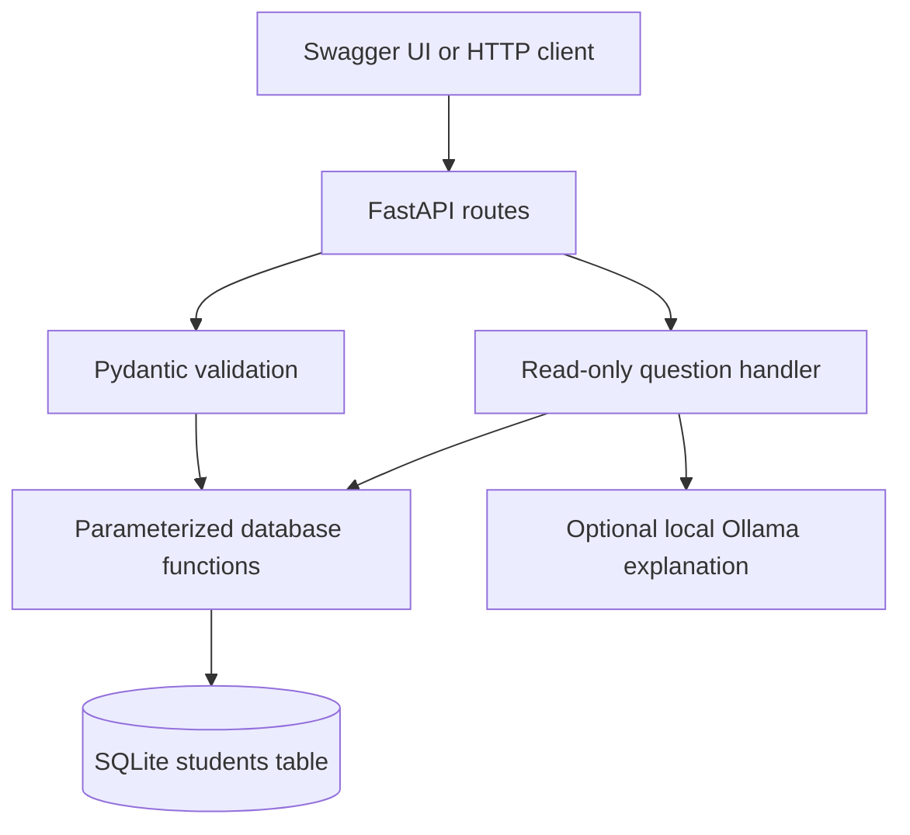

# Students Database CRUD Application

A Python backend internship project for managing student records with **FastAPI** and **SQLite**. Includes validated CRUD endpoints, search/filtering, pagination, persistent storage, automated tests and an optional local Ollama extension.

## 1. Start here (Windows)

Install **Python 3.12** (the tested version), extract this ZIP, and open a terminal inside `students-database-crud`, where this README is located. Internet access is needed for the initial dependency installation. SQLite comes with Python; no database server is required.

These commands work in PowerShell and Command Prompt without activating the environment:

```powershell
py -3.12 -m venv .venv
.venv\Scripts\python.exe -m pip install -r requirements-lock.txt
.venv\Scripts\python.exe -m uvicorn app.main:app --host 127.0.0.1 --port 8000
```

Open **http://127.0.0.1:8000/docs** for the interactive API. Click an endpoint, **Try it out**, fill the JSON and click **Execute**. The root URL returns service information; this is a backend project, with Swagger UI as its demonstration interface.

After setup, you can also double-click `start_windows.bat`. Stop the server with Ctrl+C.

## 2. Linux / macOS

```bash
python3.12 -m venv .venv
.venv/bin/python -m pip install -r requirements-lock.txt
.venv/bin/python -m uvicorn app.main:app --host 127.0.0.1 --port 8000
```

`requirements.txt` lists direct runtime dependencies. `requirements-dev.txt` adds tests. `requirements-lock.txt` pins the complete environment used for verification and is the recommended installation file for reproducing this submission.

## 3. Load fictional sample data

Keep the API terminal running. In a **second terminal**, in the same project folder:

```powershell
.venv\Scripts\python.exe -m scripts.seed
```

Linux/macOS: `.venv/bin/python -m scripts.seed`.

This loads 10 fictional student records from `examples/students.json`. Re-running skips duplicate emails; it never resets the database. The app starts empty and does not insert data automatically.

## 4. API reference

| Method | Path | Behaviour | Success |
|---|---|---|---|
| GET | `/` | Project info and documentation path | 200 |
| GET | `/health` | Check service and database | 200 |
| POST | `/students` | Create student; generated ID and Location header | 201 |
| GET | `/students` | List and filter with pagination | 200 |
| GET | `/students/{student_id}` | Retrieve one student | 200 |
| PUT | `/students/{student_id}` | Replace all editable details | 200 |
| PATCH | `/students/{student_id}` | Update only supplied fields | 200 |
| DELETE | `/students/{student_id}` | Delete a student; empty response | 204 |
| POST | `/ai/ask` | Supported read-only natural-language question | 200 |

Errors: **404** missing record; **409** duplicate email; **422** invalid input; **503** enabled Ollama service unavailable or invalid response.

Create request (paste into Swagger's POST body):

```json
{
  "name": "Demo Student",
  "date_of_birth": "2006-02-10",
  "email": "demo@example.com",
  "phone": "+91 9876543210",
  "course": "CSE",
  "address": "Fictional Campus, Demo City",
  "enrollment_date": "2025-07-15"
}
```

Use the returned `student_id` for GET, PUT, PATCH and DELETE; do not assume it will always be 1. Optional fields can be omitted. At least email or phone is required. `student_id` is generated by SQLite and cannot be supplied or modified.

Partial update:

```json
{"course": "Data Science"}
```

**PUT replaces** the record: name, birth date and at least one contact are required; omitted optional fields become null. **PATCH merges** with the existing record, then validates the full result. Explicit null clears an optional field, but the final record must still have contact information. An empty patch is rejected.

### Filters

Example: `/students?name=demo&course=CSE&born_after=2005-12-31&limit=10&offset=0`

- `name`: case-insensitive literal substring; `%` and `_` are not wildcards.
- `course`, `email`: case-insensitive exact matching.
- `born_after`, `born_before`: exclusive date bounds in `YYYY-MM-DD` format.
- Filters combine with AND. `born_after` must be earlier than `born_before` when both are present.
- `limit`: 1-100, default 20. `offset`: nonnegative, default 0.
- Response: `{ "total": 10, "limit": 20, "offset": 0, "items": [...] }`.
- Results use ascending student ID order. Empty matches return 200 and an empty `items` list.

### Validation rules

Name: 2-100 characters after trimming. Birth date: valid calendar date from 1900-01-01 through today. Email: validated format, stored lowercase, unique ignoring case. Phone: 7-15 digits with optional leading `+`, spaces, parentheses and hyphens. Course: up to 100 characters; address: up to 300. Enrollment date must not precede birth date; future enrollment is allowed. Unknown fields are rejected. No maximum age beyond the documented birth-date bound is inferred.

## 5. Postman and reproducible demo

Import `examples/Students_CRUD.postman_collection.json` into Postman. Set `base_url` if needed. A successful create automatically stores `student_id` in the collection. Use a new email for another create, or delete the existing record first.

Run an isolated CRUD demonstration without starting Uvicorn:

```powershell
.venv\Scripts\python.exe -m scripts.demo
```

This uses FastAPI's in-process TestClient with a temporary SQLite database, leaves your normal data untouched and prints actual API responses. `docs/demo_output.txt` is a captured run, not a simulated terminal screenshot. `docs/live_http_results.json` records the separate real HTTP/server-restart check.

## 6. Run the tests

```powershell
.venv\Scripts\python.exe -m pytest -q
```

Linux/macOS: `.venv/bin/python -m pytest -q`.

Tests use isolated temporary databases. Coverage includes CRUD, merged PATCH validation, duplicates and rollback, bad/missing IDs, filters, pagination, SQL-like input, persistence across application restarts, concurrent inserts, OpenAPI routes, and mocked Ollama success/failure. See `docs/test_results.txt` for the captured result. The tested dependency stack emits an upstream Starlette warning about TestClient's httpx compatibility; it does not cause a test failure.

## 7. Optional local Ollama

The core API does **not** need Ollama. `/ai/ask` understands two deliberately limited question forms even with AI disabled:

```json
{"question": "How many students are there?"}
```

```json
{"question": "List students born after 2005."}
```

The second query means birth dates after **2005-12-31**. It returns up to 100 matching records with ID, name and birth date, the total count, and a truncation flag. Unsupported questions return 422, rather than guessing a query.

To enable the additional local model explanation, install Ollama from https://ollama.com and run:

```text
ollama pull llama3.2:1b
ollama serve
```

If Ollama is already running, do not start a second instance. In the **PowerShell terminal that starts FastAPI**, set:

```powershell
$env:ENABLE_OLLAMA="true"
$env:OLLAMA_MODEL="llama3.2:1b"
.venv\Scripts\python.exe -m uvicorn app.main:app --host 127.0.0.1 --port 8000
```

Command Prompt: `set ENABLE_OLLAMA=true`, then `set OLLAMA_MODEL=llama3.2:1b`.
Linux/macOS: `export ENABLE_OLLAMA=true` and `export OLLAMA_MODEL=llama3.2:1b` before starting the server.

The endpoint always constructs the authoritative `answer` from database facts. When enabled, Ollama receives aggregate facts and supplies a separate `ollama_explanation`, which is generated text and may be imperfect. It never receives executable SQL, database access or student contact details. Set `ENABLE_OLLAMA=false` and restart to disable it. No `.env` loader is used; configure actual terminal environment variables.

**Verification boundary:** the actual Ollama model was not available in the build environment. Its API integration was verified with mocked responses and failures. Core CRUD and database question answers were executed directly.

## 8. Storage and architecture



| File / folder | Purpose |
|---|---|
| `app/main.py` | Application factory, routes, status codes |
| `app/schemas.py` | Student request/response models and validation |
| `app/database.py` | SQLite schema, queries and transactions |
| `app/ai.py` | Restricted questions and optional local AI |
| `scripts/seed.py` | Load fictional data through HTTP |
| `scripts/demo.py` | Isolated, repeatable demonstration |
| `tests/test_api.py` | Automated behavioural tests |
| `examples/` | JSON data and Postman collection |
| `docs/` | Project report, output and verification evidence |

By default records persist in `data/students.db`, resolved relative to the project location, not your current terminal folder. SQLite uses WAL mode and a 10-second lock timeout. PATCH reserves a write transaction before reading and merging. Email uniqueness is enforced by SQLite as well as checked through error handling. SQL values are bound parameters; dynamically assembled SQL uses only fixed internal field names/operators.

For another database location set `STUDENT_DB_PATH` to an absolute file path before starting the server. Stop the API before copying the database for backup; copy its WAL/SHM companions too if still present. Tests and demo use separate databases.

This is a local educational backend without authentication. It is configured to bind to localhost and includes only fictional samples. Authentication, authorization and deployment hardening are future work before using real student information or exposing it publicly.

## 9. Common setup issues

- **`py` not found:** install Python 3.12 with the launcher enabled; reopen the terminal. On Linux/macOS use `python3.12`.
- **`No module named fastapi` / `uvicorn`:** install requirements using the same `.venv` interpreter shown above.
- **Could not import `app`:** open the project folder containing `app/` and `README.md` before running commands.
- **Port 8000 occupied:** stop the other server or use `--port 8001`; open `/docs` on that port and seed with `--url http://127.0.0.1:8001`.
- **409 on create:** that email exists; edit the email, use PATCH, or skip re-creating it.
- **422:** inspect the response detail and check date format, contact fields and unexpected keys.
- **Swagger assets unavailable offline:** Swagger UI loads assets from a CDN. Use Postman or the demo script for API testing when those assets cannot load.
- **Ollama 503:** confirm the service/model is installed and running; disable the extension to use the independent CRUD application.

## 10. Submission and demonstration

1. Complete setup and run the tests.
2. Start the server, seed samples, and demonstrate POST, GET/filter, PATCH/PUT and DELETE through `/docs`.
3. Stop/restart the API and retrieve an existing record to demonstrate persistence.
4. Create your own GitHub repository and upload this project's source files. `.gitignore` excludes local databases, environments and secrets.
5. Submit the actual repository URL through your trainer's channel. No repository URL has been invented in this package.

`docs/Project_Report.pdf` contains the objective, design, schema, implementation summary, verification and limitations. The application meets the assignment's mandatory backend scope; a separate frontend is not required.

### References

- FastAPI testing: https://fastapi.tiangolo.com/tutorial/testing/
- FastAPI lifespan testing: https://fastapi.tiangolo.com/advanced/testing-events/
- Ollama structured outputs/API: https://github.com/ollama/ollama/blob/main/docs/api.md
- Python SQLite: https://docs.python.org/3/library/sqlite3.html
